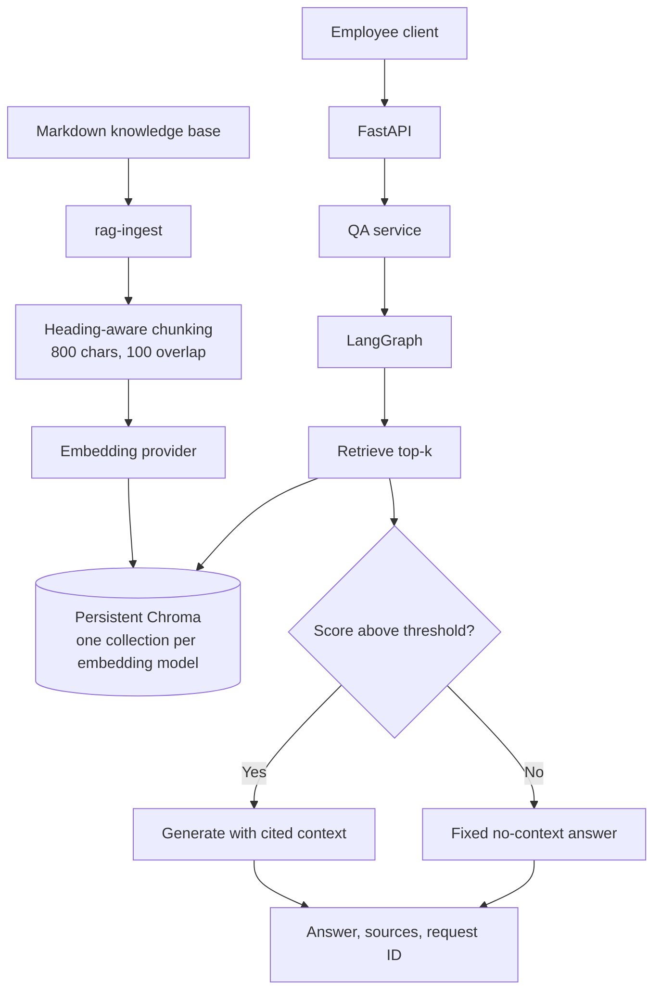

# Acme Corp IT Helpdesk RAG

A small retrieval-augmented question-answering backend for the fictional Acme Corp IT helpdesk. Employees can ask common IT questions and receive answers grounded in an included Markdown knowledge base, with source citations.

## 1. Problem and Features

The L1 helpdesk handles many repeated questions about VPN access, passwords, MFA, laptops, software, Wi-Fi, printing, security, and support contacts. This service demonstrates how a compact RAG backend can retrieve relevant internal guidance before asking a language model to answer.

Features:

- `POST /ask` retrieves relevant passages and returns an answer with source document, chunk ID, relevance score, and snippet.
- `GET /health` reports configured providers and whether the local index contains chunks.
- `uv run rag-ingest` chunks the Markdown knowledge base, creates embeddings, and persists a local Chroma index.
- OpenAI and local Ollama providers can be selected independently through environment settings. Deterministic fake components are provided for tests.
- Request IDs, structured error responses, asynchronous model calls, concurrency limits, timeouts, and transient-error retries are included.

The sample Acme policies, URLs, and phone numbers are fictional and use reserved `.example` domains and example-number ranges.

## 2. Architecture and Design Decisions



Ingestion is a separate command. The API does not parse source files or create embeddings at startup; it opens the configured persistent collection and reports an empty or missing index as unavailable to `/ask`.

Key decisions and trade-offs:

- Markdown headings are section boundaries, followed by chunks of about 800 characters with 100 characters of overlap. This keeps small procedures and their titles together without adding a heavyweight document-processing pipeline.
- Chroma runs locally and persists to `storage/`. Collections are named using the embedding model so vectors from models with different dimensions are not mixed.
- Chroma cosine relevance scores are normalized to a 0-to-1 range. Results below `RETRIEVAL_SCORE_THRESHOLD` are removed before the graph chooses its answer branch. Scores are ranking signals, not calibrated probabilities.
- The answer prompt only supplies retrieved passages and asks the model to cite sources. This reduces unsupported answers but cannot guarantee that every generated statement is correct.
- The response includes source metadata separately from the answer, so clients can inspect the evidence even if the model formats citations imperfectly.

## 3. Project Structure

```text
app/
	api/          FastAPI routes, request/response schemas, middleware, errors, DI
	core/         Settings and logging
	providers/    LLM, embedding, and vector-store factories/adapters
	rag/          Markdown loading, chunking, ingestion, LangGraph pipeline
	services/     QA orchestration, timeout, semaphore, retry, domain errors
data/docs/      Fictional Acme IT helpdesk knowledge base
tests/          Unit tests with fake components and opt-in provider integration test
Dockerfile
docker-compose.yml
pyproject.toml  Project metadata, dependencies, scripts, Ruff and pytest settings
uv.lock         Locked dependency versions
```

## 4. Installation, Indexing, and Running

Requirements: Python 3.12, [uv](https://docs.astral.sh/uv/), and a running Ollama server for local model use. Docker Desktop is optional if using the Compose setup.

### Local setup

From the repository root:

```powershell
uv python install 3.12
uv sync --frozen
Copy-Item .env.example .env
```

On Bash, use `cp .env.example .env` instead. The `.env` file is git-ignored; keep real credentials there or in the process environment and never commit them.

Start Ollama, download the local models, build the index, and start the API:

```powershell
ollama pull llama3.2:3b
ollama pull nomic-embed-text
uv run rag-ingest
uv run uvicorn app.main:app --reload
```

The API is available at `http://127.0.0.1:8000`; interactive OpenAPI documentation is at `http://127.0.0.1:8000/docs`.

### Docker Compose

Copy `.env.example` to `.env`, then run:

```powershell
docker compose up --build
```

Compose starts the Ollama server, pulls `llama3.2:3b` and `nomic-embed-text` if needed, runs the one-shot ingestion service, and starts the API after ingestion succeeds. Models persist in the `ollama-models` volume and the vector index in `rag-storage`. The API is published on port 8000. Stop the services with `docker compose down`; named volumes are preserved. To remove the downloaded models and index as well, use `docker compose down --volumes`.

### Tests and lint

```powershell
uv run pytest -q
uv run ruff check .
uv run ruff format --check .
```

The integration test is excluded by default. Run it explicitly after configuring and starting a real provider:

```powershell
uv run pytest -m integration -q
```

## 5. Cloud and Local Model Modes

Provider selection is independent for generation and embeddings.

| Mode | LLM | Embeddings | Configuration |
|---|---|---|---|
| OpenAI | `gpt-4o-mini` | `text-embedding-3-small` | Set both providers to `openai` and provide `OPENAI_API_KEY` |
| Ollama | `llama3.2:3b` | `nomic-embed-text` | Set both providers to `ollama`; set `OLLAMA_BASE_URL` if the server is not at `http://localhost:11434` |
| Fake | Fixed test model | Deterministic local test embeddings | `fake`; intended for tests, not production answers |

For example, set `LLM_PROVIDER=openai`, `EMBEDDING_PROVIDER=openai`, and `OPENAI_API_KEY` in your ignored `.env`. The application fails early with a clear configuration error if OpenAI is selected without a key. OpenAI usage can incur charges; review the provider's pricing and data-handling terms before sending company data.

For a fully local, API-key-free setup, use Ollama for both providers. Download both models before indexing. A model change does not automatically re-embed existing chunks: after changing the embedding provider or model, run `uv run rag-ingest` again. The new model uses a separate collection; the previous collection remains on disk.

The `llama3.2:3b` model requires approximately 2.3 GB of disk for the model files. Plan for about 8 GB of system RAM for a practical local setup; CPU inference can be slow, while a compatible GPU can improve throughput. Local models avoid sending prompts to a hosted model provider, but may be slower and produce weaker answers than the cloud model.

## 6. Example Requests

`POST /ask` accepts a non-blank question up to 1000 characters. `top_k` is optional and must be between 1 and 10; when omitted, `RETRIEVAL_TOP_K` is used.

### Bash

```bash
curl -sS http://127.0.0.1:8000/ask \
	-H 'Content-Type: application/json' \
	-H 'X-Request-ID: helpdesk-demo-001' \
	-d '{"question":"How do I connect to the company VPN?","top_k":4}'
```

### PowerShell

```powershell
$body = @{
		question = "How do I connect to the company VPN?"
		top_k = 4
} | ConvertTo-Json -Compress
$requestFile = Join-Path $env:TEMP "helpdesk-ask.json"
[System.IO.File]::WriteAllText($requestFile, $body, [System.Text.UTF8Encoding]::new($false))

curl.exe -sS http://127.0.0.1:8000/ask `
		-H "Content-Type: application/json" `
		-H "X-Request-ID: helpdesk-demo-001" `
	--data-binary "@$requestFile"

Remove-Item $requestFile
```

Example response:

```json
{
	"answer": "Install Acme SecureConnect from Software Center, connect to vpn.acme.example, and approve the MFA prompt. [vpn-setup.md: Connecting]",
	"answered": true,
	"sources": [
		{
			"document": "vpn-setup.md",
			"chunk_id": "vpn-setup:3:0",
			"score": 0.82,
			"snippet": "Connecting: Start Acme SecureConnect from the system tray..."
		}
	],
	"request_id": "helpdesk-demo-001"
}
```

The exact answer, scores, chunk IDs, and number of sources depend on the index and model. If the index is available but no result passes the threshold, the API returns HTTP 200 with `answered: false`, an empty `sources` array, and a fixed no-context answer; the LLM is not called. If the index is empty or unavailable, `/ask` returns 503.

Check health:

```bash
curl -sS http://127.0.0.1:8000/health
```

Errors use one format for validation (422), model failure (502), index unavailable (503), timeout (504), and unexpected failure (500):

```json
{
	"error": {
		"code": "validation_error",
		"message": "Request validation failed.",
		"request_id": "helpdesk-demo-001"
	}
}
```

The request ID is returned in both the response body and the `X-Request-ID` header. If the client omits the header, the API generates one. OpenAPI examples are available at `/docs`.

## 7. Concurrency and Scaling

### How are concurrent requests isolated?

Each request passes its question and retrieved documents through its own LangGraph state. The graph is compiled once per service instance at startup; requests do not mutate a shared conversation or document state.

### What happens to blocking work?

FastAPI routes and graph nodes are asynchronous. Chroma's synchronous local search and count operations run through `asyncio.to_thread` so they do not block the event loop.

### How are language-model calls bounded?

An `asyncio.Semaphore` limits simultaneous model calls per application process using `MAX_CONCURRENT_LLM_CALLS`. `asyncio.wait_for` applies `LLM_TIMEOUT_SECONDS`. Only transient connection failures, HTTP 429, and HTTP 5xx model errors are retried, with at most three attempts and exponential backoff; validation and other non-transient errors are not retried.

### What is the current overload behavior?

The service bounds concurrent LLM calls but does not yet have a request queue policy, rate limiting, authentication, or a dedicated overload response. Under sustained load, requests may wait for a semaphore slot or time out. Add a bounded queue and return 429 or 503 before accepting more work when deploying beyond a small demonstration.

### What is ready to scale, and what comes next?

Requests are stateless, so additional API processes or replicas are a possible next step. The current semaphore is per process, and local Chroma storage is not a shared multi-replica database; scale-out therefore needs a shared vector database and coordinated ingestion. Further steps include background ingestion, caching, rate limits, and metrics for p95 request latency, LLM latency, error rate, token usage, and queue length. These are not implemented in this demo.

## 8. Limitations and Next Steps

- The knowledge base is a small, hand-written sample; it is not an authoritative company policy source.
- Chunking uses character lengths and heading boundaries, not model token counts. Tables, long sections, or unusual Markdown may need a more tailored splitter.
- Retrieval score thresholds require tuning against a representative question set. Cosine relevance scores are not probabilities and can differ between embedding models.
- The fake embedding provider is deterministic and useful for tests; it is not semantically representative of a production embedding model.
- There is no authentication, authorization, rate limiting, persistent request history, or monitoring/metrics endpoint.
- Local Chroma is suitable for a single instance, not coordinated multi-worker or multi-replica writes. The local semaphore also does not coordinate across processes.
- Docker Compose currently demonstrates the Ollama mode. The container uses `ollama/ollama:latest`, so a production deployment should pin and update that image deliberately.
- The Docker image and Compose flow were verified from a clean clone: the app image built, Ollama downloaded both models, ingestion indexed 55 chunks, and the health and question-answering endpoints worked. The Compose Ollama image is several gigabytes and requires a separate model download into its named volume.

Reasonable next steps are a shared vector database for horizontal scale, request authentication and rate limits, a bounded work queue, quality evaluation over curated question/answer pairs, and production metrics and tracing.
